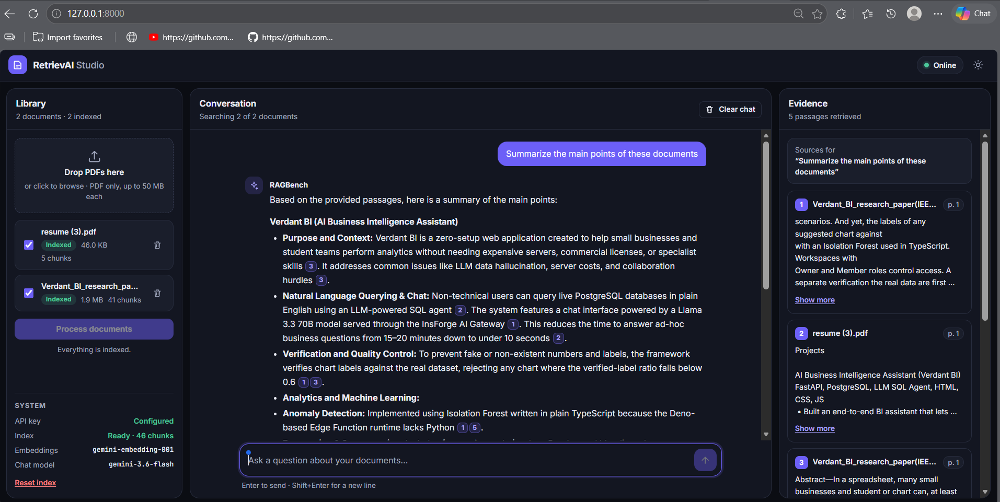
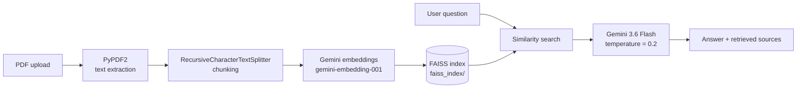

# RAGBench

**Intelligent document Q&A over your PDFs, powered by Gemini and FAISS.**




---

## Table of Contents

- [Overview](#overview)
- [Features](#features)
- [Architecture](#architecture)
- [Tech Stack](#tech-stack)
- [Project Structure](#project-structure)
- [Getting Started](#getting-started)
- [Usage](#usage)
- [API Reference](#api-reference)
- [Security](#security)
- [Notes and Limitations](#notes-and-limitations)

---

## Overview

RAGBench is a Retrieval-Augmented Generation (RAG) application that lets you upload PDF documents and ask questions about their content. Answers are generated by Gemini using only the passages retrieved from your documents, and every answer shows the exact source chunks it was based on.

The project was migrated from a single-file Streamlit app to a **FastAPI backend** with a **vanilla HTML/CSS/JS frontend**. The RAG pipeline itself is unchanged.

## Features

- **Multi-PDF upload**: drag and drop or browse for one or more PDF files.
- **End-to-end RAG pipeline**: text extraction, chunking, embedding, indexing and retrieval in one click.
- **Grounded answers**: the model answers strictly from retrieved context and replies with exactly `Answer is not available in the context.` when the answer is not present.
- **Source transparency**: expand **Retrieved sources** under any answer to inspect the chunks passed to Gemini.
- **Markdown-rendered responses** in a clean, responsive UI.
- **Persistent index**: the FAISS index is saved to disk and reused between runs.
- **Single server**: FastAPI serves both the API and the frontend.
- **Secure key handling**: the Google API key stays on the backend.

## Architecture



**Pipeline stages**

| Stage | Component | Details |
|-------|-----------|---------|
| 1. Extraction | PyPDF2 | Reads text from every uploaded PDF |
| 2. Chunking | `RecursiveCharacterTextSplitter` | Splits text into overlapping chunks |
| 3. Embedding | `models/gemini-embedding-001` | Converts chunks into vectors |
| 4. Indexing | FAISS | Stored locally in `faiss_index/` |
| 5. Retrieval | FAISS similarity search | Finds the chunks most relevant to the question |
| 6. Generation | Gemini 3.6 Flash (`temperature=0.2`) | Answers from the retrieved context only |

## Tech Stack

| Layer | Technology |
|-------|------------|
| Backend | FastAPI, Uvicorn |
| Frontend | HTML, CSS, vanilla JavaScript |
| LLM and embeddings | Google Gemini via `langchain-google-genai` |
| Vector store | FAISS (`faiss-cpu`) |
| PDF and text processing | PyPDF2, `langchain-text-splitters` |
| Configuration | `python-dotenv` |

## Project Structure

```
RAGBench_project/
├── backend/
│   ├── __init__.py
│   ├── main.py            # FastAPI app: /api/* routes + serves the frontend
│   └── rag_engine.py      # RAG pipeline (ported from app.py, UI-free)
├── frontend/
│   ├── index.html
│   ├── css/style.css
│   └── js/app.js
├── docs/
│   └── project_working.png
├── uploads/               # Uploaded PDFs land here
├── faiss_index/           # Persisted FAISS index
├── .env                   # GOOGLE_API_KEY=... (create this yourself, gitignored)
├── .env.example
├── .gitignore
├── requirements.txt
└── README.md
```

## Getting Started

### Prerequisites

- Python 3.10 or newer
- A Google API key with access to the Gemini API
- A virtual environment (recommended)

### Installation (Windows / PowerShell)

From `D:\RAGBench_project`, with your existing virtual environment active:

```powershell
(.venv) PS D:\RAGBench_project> pip install -r requirements.txt
```

### Configuration

Create a `.env` file in the project root. It is already listed in `.gitignore`, so never commit it.

```env
GOOGLE_API_KEY=your_google_api_key
```

### Run

```powershell
(.venv) PS D:\RAGBench_project> uvicorn backend.main:app --reload
```

Then open:

```
http://127.0.0.1:8000
```

FastAPI serves both the API and the frontend, so this is the only server you need to run. The old `python -m streamlit run app.py` command is no longer used.

## Usage

1. **Upload**: in the **Documents** sidebar, drop or browse one or more PDF files.
2. **Process**: click **Process Documents**. This uploads the files, extracts text with PyPDF2, splits it with `RecursiveCharacterTextSplitter`, embeds it with `models/gemini-embedding-001`, and rebuilds the FAISS index at `faiss_index/`.
3. **Ask**: once the index shows **Ready**, type a question in the main panel and press Enter or click **Ask RAGBench**.
4. **Verify**: expand **Retrieved sources** under any answer to see the exact chunks that were passed to Gemini as context.

If a question cannot be answered from the retrieved context, the model responds with exactly:

```
Answer is not available in the context.
```

## API Reference

All routes are prefixed with `/api`.

| Method | Route | Purpose |
|--------|-------|---------|
| `GET` | `/api/status` | API-key and FAISS-index readiness, model names |
| `POST` | `/api/upload` | Multipart upload of one or more PDFs |
| `POST` | `/api/process` | Runs the extraction, chunking, embedding and FAISS pipeline on everything in `uploads/` |
| `POST` | `/api/ask` | Takes `{ "question": "..." }`, returns a similarity-search-grounded Gemini answer plus sources |

**Example: ask a question**

```bash
curl -X POST http://127.0.0.1:8000/api/ask \
  -H "Content-Type: application/json" \
  -d '{"question": "What are the main conclusions of the document?"}'
```

FastAPI also exposes interactive API docs at `http://127.0.0.1:8000/docs`.

## Security

- `GOOGLE_API_KEY` is read from `.env` via `python-dotenv` and never leaves the backend. It is never sent to, stored in, or displayed by the frontend.
- `.env`, uploaded files and the FAISS index are excluded from Git via `.gitignore`.
- `/api/upload` accepts `.pdf` files only.

## Notes and Limitations

- Re-processing documents **rebuilds the FAISS index from scratch**, the same behavior as the original Streamlit app.
- Processing runs on every file currently in `uploads/`.
- Scanned PDFs without a text layer will not yield extractable text.

## live Demo 
'''
https://retrievai-1-064h.onrender.com/
'''
